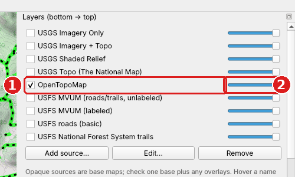
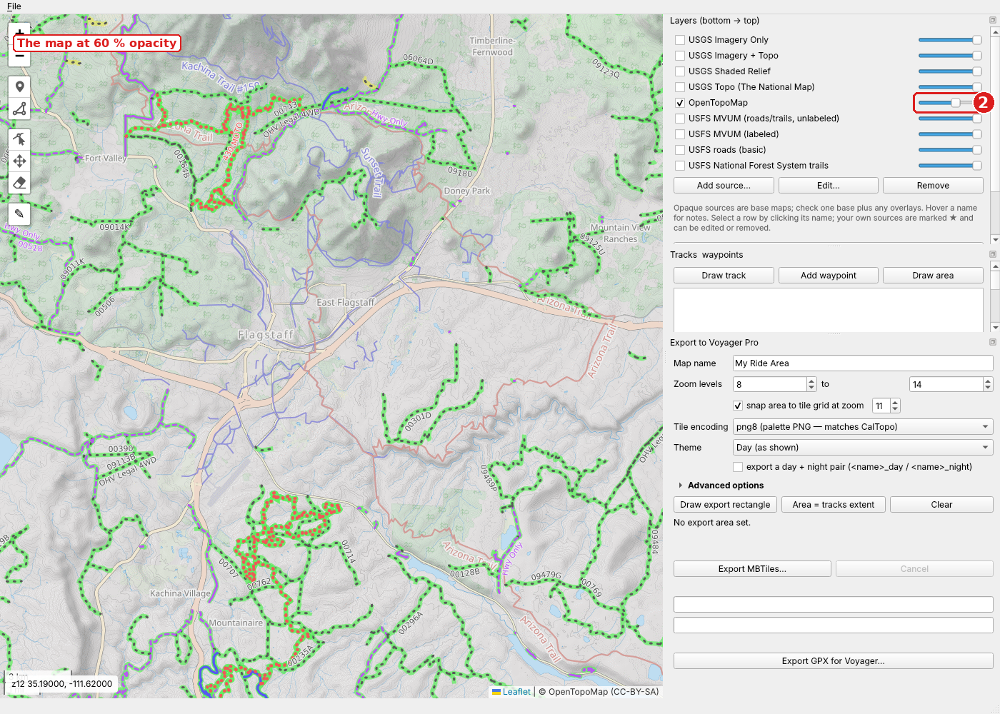
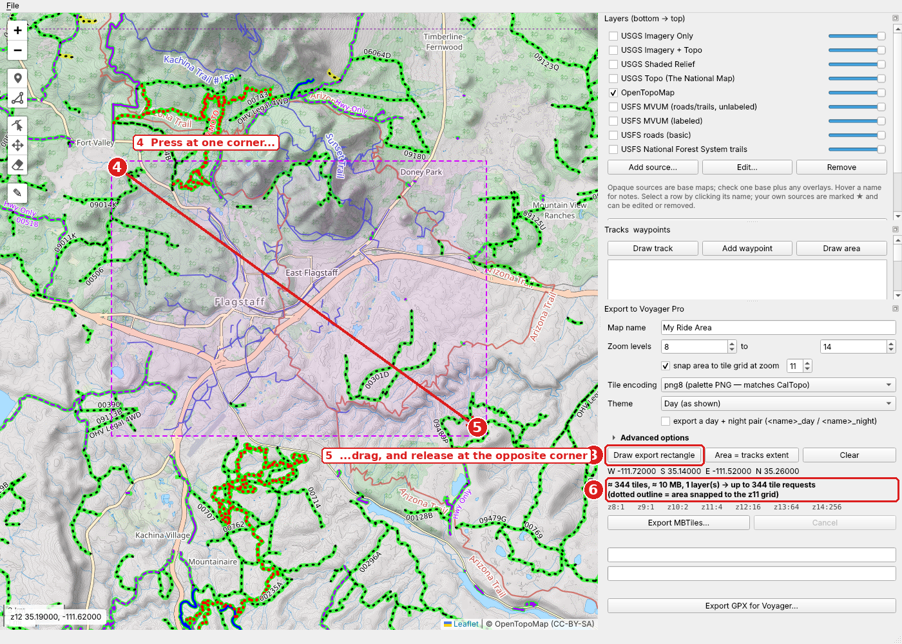
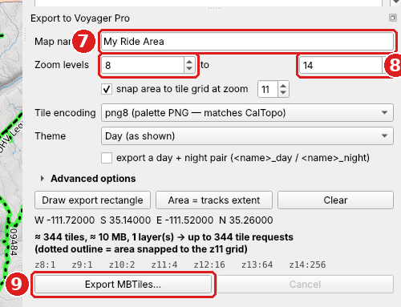
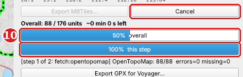

# VoyagerMapper quick start

This guide shows how to install VoyagerMapper on Windows and the four steps
to make a map file for the Trail Tech Voyager Pro. The default settings make
a file that loads on the device. You do not have to change them.

## 0. Install and start the app

You do this once. You need an internet connection. If you prefer an
installer, download `voymap-setup-<version>.exe` from the
[Releases page](https://github.com/GnomeTek/VoyagerMapper/releases) and skip
to step 0.4.

### 0.1 Install Python

1. Open <https://www.python.org/downloads/> and download Python for Windows
   (3.10 or newer).
2. Start the installer.
3. On the first screen, check **Add python.exe to PATH**.
4. Click **Install Now** and wait for the installer to finish.

If Python is already installed, skip this step.

### 0.2 Download the source

1. Open <https://github.com/GnomeTek/VoyagerMapper>.
2. Click the green **Code** button.
3. Click **Download ZIP**.
4. Open the downloaded file `VoyagerMapper-main.zip` and extract it to a
   folder you keep, for example `C:\Users\<you>\Documents\VoyagerMapper`.

The folder must contain `setup.bat`, `run_gui.bat`, and `pyproject.toml`.

If you use git, you can instead run
`git clone https://github.com/GnomeTek/VoyagerMapper.git`.

### 0.3 Run setup

1. Open the folder from step 0.2.
2. Double-click **`setup.bat`**.

A command window opens. The script makes a Python environment in a `.venv`
subfolder, installs the app and its libraries (about 200 MB, most of it the
Qt map view), and runs the self-test. This takes a few minutes. The last
lines you see are:

```
26 passed in ...s

Setup complete. Double-click run_gui.bat to start voymap.
Press any key to continue . . .
```

Press a key to close the window. If the window shows `Setup failed`, read
the lines above it. The usual cause is that Python is not on the PATH:
repeat step 0.1 and make sure the **Add python.exe to PATH** box is checked.

### 0.4 Start the app

1. Double-click **`run_gui.bat`** in the same folder.
2. Wait for the window with the map to open.

If you used the installer, start **voymap** from the Start menu instead.

The map starts on northern Arizona. Pan and zoom to your riding area. A
command window stays open behind the app while it runs. Close the app to
close it.

## 1. Select the map and set the opacity



1. In the **Layers** panel, check the box next to the map you want **(1)**.
   Check one base map, for example *OpenTopoMap* or *USGS Topo*. You can
   also check overlays, for example *USFS MVUM (labeled)*.
2. Drag the slider at the right of the row to set the opacity **(2)**. The map
   view shows the result at once.



The slider also sets the opacity in the exported file. For a base map, keep
the slider at 100 %. Use a lower value for an overlay that hides the base map.

## 2. Draw the export area



1. In the **Export to Voyager Pro** panel, click **Draw export rectangle** **(3)**.
2. On the map, press the mouse button at one corner of the area **(4)**.
3. Hold the button, drag to the opposite corner, and release **(5)**.

The app shows the area as a dashed magenta rectangle. The line under the
buttons shows the tile count and the approximate file size **(6)**. A thin
dotted outline shows the area snapped to the tile grid. That is the area the
app exports.

To change the area, click **Draw export rectangle** again and draw a new
rectangle. **Clear** removes the area.

## 3. Export the map



1. Type a name in **Map name** **(7)**. The Voyager Pro shows this name in its
   list of custom maps.
2. Keep the **Zoom levels** at the default, 8 to 14 **(8)**. More zoom levels
   make a larger file. Each level above 14 makes the file four times larger.
3. Click **Export MBTiles...** **(9)**.
4. In the file dialog, choose where to save the `.mbtiles` file and click
   **Save**.



The top bar shows the overall progress **(10)**. The bottom bar shows the
current step. The export downloads the tiles for each layer, then writes the
file. A message box opens when the export is complete. **Cancel** stops the
export.

## 4. Load the map on the Voyager Pro

1. Copy the `.mbtiles` file to the microSD card of the Voyager Pro.
2. Put the card in the Voyager Pro.
3. On the device, go to the map screen.
4. Tap **CUSTOM MAPS**.
5. Tap **IMPORT A NEW FILE** and select the file.

The device processes the file and shows a message when it is done.

## Tips

- The app keeps the downloaded tiles in a cache. A second export of the same
  area, for example a night version, does not download the tiles again.
- Select **Night** in **Theme** to make a dark map. Check **export a day +
  night pair** to make both files in one export.
- **File → Save project** saves the area, the layers, and the export
  settings, so you can make the same map again later.
